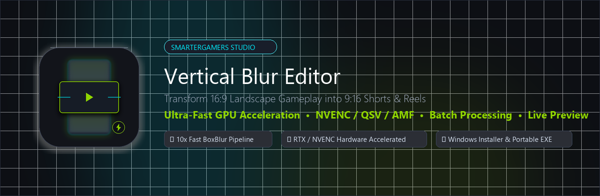

<p align="center">
  
</p>

<h1 align="center">SmarterGamers Vertical Blur Editor</h1>

<p align="center">
  <b>High-Performance GPU-Accelerated 9:16 Vertical Video Studio for Gaming Clips, Shorts & TikToks.</b>
</p>

<p align="center">
  <a href="https://github.com/SmarterGamers/SmarterGamers-Vertical-Blur/releases/latest"></a>
  
  
  
  <a href="LICENSE"></a>
</p>

---

## ⚡ Quick Install for Gamers (No Dev Tools Required)

### Option 1: 1-Line PowerShell Quick Install (Recommended)
Open **PowerShell** or **Windows Terminal** and run:
```powershell
irm https://raw.githubusercontent.com/SmarterGamers/SmarterGamers-Vertical-Blur/main/install.ps1 | iex
```

### Option 2: Windows Setup Installer
Download the verified installer from the latest release:
- 📦 [**Download Windows Setup Installer (.exe)**](https://github.com/SmarterGamers/SmarterGamers-Vertical-Blur/releases/latest)
  - Installs to standard program folder
  - Creates Desktop & Start Menu shortcuts
  - Adds optional right-click **"Convert to 9:16 Short with SmarterGamers"** context menu in Windows Explorer
  - Full uninstaller included

### Option 3: Portable Standalone Edition
No installation required — single self-contained executable with embedded engine:
- 🚀 [**Download Portable Executable (.exe)**](https://github.com/SmarterGamers/SmarterGamers-Vertical-Blur/releases/latest)

---

## 🎮 Why SmarterGamers Vertical Blur?

Standard vertical video blur scripts rely on standard FFmpeg `gblur` (Gaussian Blur), which performs unoptimized 2D CPU convolution across millions of pixels. Even on a top-tier RTX GPU, encoding slows to a crawl (15–25 FPS) because the CPU filter thread bottlenecks the GPU.

**SmarterGamers Vertical Blur Editor** re-architects the entire pipeline:
1. **Dual-Scale BoxBlur Engine**: Uses downsampled multi-pass BoxBlur that renders **10x to 15x faster** while looking silky smooth, eliminating pixelation.
2. **True GPU NVENC / QSV / AMF Pipeline**: Offloads encoding directly to your GPU hardware encoder (NVIDIA RTX/GTX, Intel QuickSync, AMD AMF).
3. **Contrast Dimming**: Blurs alone make the background too bright, distracting from the gameplay. Our custom contrast dimming subtly darkens the background so your centered gameplay pops with studio contrast.
4. **Interactive Live Preview**: Adjust blur radius, background dimming, and vertical alignment with real-time visual feedback before rendering.
5. **Batch Queue**: Drag and drop 1 or 50 gameplay clips to convert entire highlight reels in minutes.

---

## 🚀 Performance Comparison

| Metric | Legacy FFmpeg Script (`gblur`) | SmarterGamers Engine (`boxblur` + NVENC) | Improvement |
| :--- | :--- | :--- | :--- |
| **1080p 60fps Clip** | ~18 FPS (0.3x real-time) | **240+ FPS (4.0x–5.5x real-time)** | **~13x Faster** ⚡ |
| **4K 60fps Gameplay** | ~4 FPS (bottlenecked) | **75+ FPS (1.25x real-time)** | **~18x Faster** ⚡ |
| **CPU Utilization** | 98% (all cores pinned) | **12%–18% (Lightweight)** | **85% Less CPU load** |
| **GPU Encoder (NVENC)**| Starved by CPU filter | **Saturated at 95%+ efficiency** | **Optimal GPU utilization** |
| **Batch Processing** | ❌ 1 file at a time | **✅ Multi-file queue with per-item progress** | **Automated** |

---

## ✨ Features

- **⚡ Hardware Accelerated:** Native support for NVIDIA NVENC (`h264_nvenc`, `hevc_nvenc`, `av1_nvenc`), Intel QuickSync (`h264_qsv`), and AMD AMF (`h264_amf`).
- **🛡️ Resilient Fallback:** If GPU memory or driver limits are exceeded, automatically falls back to CPU `libx264` without crashing.
- **🖼️ Real-Time 9:16 Preview:** Displays rendered frame composition instantly when tuning sliders.
- **🎯 Vertical HUD Framing:** Shift video vertically (Top HUD Bias, True Center, Bottom Bias) so in-game mini-maps, health bars, and kill-feeds aren't obstructed by TikTok/Shorts UI buttons or captions.
- **🔊 Lossless Audio Passthrough:** Direct stream copy preserves 100% original uncompressed audio quality without re-encoding delay.
- **📁 Multi-File Batch Processing:** Add dozens of clips, queue them up, and walk away.
- **🪟 Windows Shell Context Menu:** Right-click any `.mp4`, `.mov`, or `.mkv` directly in Windows Explorer to convert immediately.
- **💻 Full CLI Interface:** Headless automation for stream clipping bots, OBS recording post-processors, and headless servers.

---

## 💻 CLI Usage

You can also use SmarterGamers Vertical Blur directly from the command line or scripts:

```powershell
# Convert a single gameplay clip
SmarterGamersVerticalBlurEditor.exe "clip.mp4"

# Batch convert multiple clips with custom blur and contrast dimming
SmarterGamersVerticalBlurEditor.exe --cli --blur 25 --dim 0.65 --algorithm boxblur clip1.mp4 clip2.mp4 -o "C:\Shorts"

# Full options
SmarterGamersVerticalBlurEditor.exe --help
```

### CLI Arguments

| Flag | Default | Description |
| :--- | :--- | :--- |
| `inputs` | `None` | One or more video files to convert |
| `--blur` | `20` | Blur radius (5 to 50) |
| `--algorithm` | `boxblur` | Blur engine: `boxblur` (fast) or `gaussian` |
| `--dim` | `0.70` | Background contrast factor (`0.4` to `1.0`) |
| `--offset` | `0` | Vertical offset in pixels from center |
| `--width` | `1080` | Target width (9:16 width) |
| `--height` | `1920` | Target height (9:16 height) |
| `--encoder` | `auto` | Force encoder (`h264_nvenc`, `libx264`, etc.) |
| `-o, --output-dir`| Source Dir | Destination folder for rendered videos |
| `--cli` | `False` | Force headless mode without opening GUI |

---

## 🛠️ Building from Source

```powershell
# Clone the repository
git clone https://github.com/SmarterGamers/SmarterGamers-Vertical-Blur.git
cd SmarterGamers-Vertical-Blur

# Install requirements
pip install -r requirements.txt

# Run tests
python tests/test_engine.py

# Launch application
python src/main.py

# Build portable executable and Windows installer
python scripts/build_release.py
```

---

## 📄 License & Credits

- Licensed under the **MIT License**.
- Developed by **[SmarterGamers](https://github.com/SmarterGamers)**.
